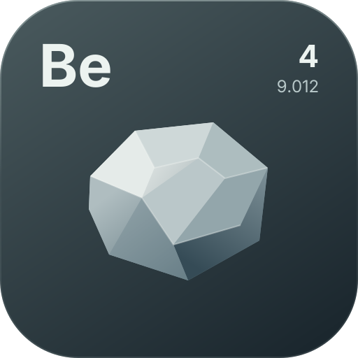

<p align="center">
  
</p>

<h1 align="center">Beryllium</h1>

Beryllium is a client-side renderer and UI API for Fabric mods on Minecraft 26.3. It provides an immediate-mode 2D/3D drawing layer, MSDF text, SVG images, a retained-mode UI framework, anchored HUD overlays, and a small synchronous event bus.

The renderer is backend-agnostic: it uses Blaze3D's renderpearl `GpuDevice` / `CommandEncoder` / `RenderPass` abstraction and contains no direct OpenGL calls, so the same code runs on the OpenGL and Vulkan backends.

## Features

| Area | What it provides |
|---|---|
| 2D renderer | GUI-space rectangles, gradients, outlines, rounded rectangles, SDF panels with fill/border/shadow, triangles, circles, arcs, lines, images, texture regions, and transforms |
| 3D renderer | Depth-tested world quads, box faces, lines, box edges, and textured quads that reuse the active world projection |
| Text | Multi-channel signed distance field glyphs, regular and bold Inter faces, runtime font registration, wrapping, measurement, shadows, per-frame prewarming, and a glyph atlas |
| Extensions | Custom render pipelines with extra uniform buffers and texture bindings, raw vertex meshes, nearest/linear sampling, offscreen render targets, runtime texture uploads, and custom MSDF font faces registered from mod assets |
| SVG | Parsed and rasterized SVG resources, files, or inline markup with deferred GPU upload and optional hot reload for file-backed images |
| Retained UI | View tree, measure/arrange layout, focus and input routing, animation, components, and a Kotlin DSL |
| HUD layer | Anchored HUD entities, independent open/close state, a HUD editor, and input routing while chat or the editor is open |
| Events | Priority-ordered synchronous events for frames, world rendering, ticks, mouse input, keyboard input, and character input |
| Verification | A dev-only end-to-end selftest harness with pixel assertions and captured screenshots |

## Requirements

| Requirement | Version |
|---|---|
| Minecraft | 26.3 |
| Fabric Loader | 0.20.1 or newer |
| Fabric API | 0.165.0+26.3 or compatible |
| Fabric Language Kotlin | 1.14.2 or compatible |
| Java | 25 |
| Kotlin | 2.4.x |
| Graphics API | OpenGL or Vulkan through the vanilla backend |

Beryllium is a client-only mod and is not intended for dedicated servers.

## Installation

Build the project and place the resulting jar in the game's `mods` directory together with Fabric API and Fabric Language Kotlin:

```
gradlew build
```

The jar is written to `build/libs/`. On Windows use `gradlew.bat`; on other platforms use `./gradlew`.

### Using Beryllium from another mod

For a Loom-based Fabric project, depend on the built jar as a mod dependency:

```kotlin
dependencies {
    modImplementation(files("libs/beryllium-1.0.0.jar"))
}
```

The consuming mod must also declare the same Minecraft, Fabric Loader, Java, Fabric API, and Fabric Language Kotlin constraints, and Beryllium must be present in the runtime mod set.

## Quick start

Beryllium initializes itself from its Fabric client entrypoint. There is no setup call, no renderer bootstrap, and no manual event registration for the core systems: subscribing to an event is enough.

### Draw a 2D overlay

Draw at a priority greater than `-100`, because the renderer flushes its 2D batches at that priority.

```kotlin
import wtf.traumadev.beryllium.event.EventBus
import wtf.traumadev.beryllium.event.impl.FrameEvent
import wtf.traumadev.beryllium.render.Colors
import wtf.traumadev.beryllium.render.Renderer

EventBus.subscribe<FrameEvent>(priority = 0) { event ->
    if (event.phase != FrameEvent.Phase.END) return@subscribe

    val gui = Renderer.gui
    gui.sdfRect(
        16f,
        16f,
        200f,
        64f,
        radius = 12f,
        fill = Colors.hex("#1A1A22"),
        borderColor = Colors.hex("#3A3A48"),
        borderWidth = 1f,
        shadowColor = Colors.withAlpha(Colors.BLACK, 100),
        shadowSpread = 8f,
    )
    gui.text("Beryllium", 28f, 26f, 18f)
}
```

`Renderer.gui` draws in vanilla GUI-scaled pixels. Use `pushScissor` / `popScissor` for clipping, and `pushMatrix` / `popMatrix` for local transforms. Keep no per-frame state in the renderer: every batch is cleared by its flush each frame.

### Draw in the world

World overlays are drawn during `WorldRenderEvent`. Pass the received event to every call so positions are rebased against the camera and the correct projection is used.

```kotlin
import wtf.traumadev.beryllium.event.EventBus
import wtf.traumadev.beryllium.event.impl.WorldRenderEvent
import wtf.traumadev.beryllium.render.Colors
import wtf.traumadev.beryllium.render.Renderer

EventBus.subscribe<WorldRenderEvent> { event ->
    Renderer.world.boxEdges(
        -0.5, 0.0, -0.5,
        0.5, 1.0, 0.5,
        2.0f,
        Colors.hex("#55CCFF"),
        event,
    )
}
```

### Build a UI screen

Subclass `Ui`, build a view tree with the DSL, register the entity, and open it. Only one `Ui` can be open at a time.

```kotlin
import wtf.traumadev.beryllium.ui.Ui
import wtf.traumadev.beryllium.ui.UiManager
import wtf.traumadev.beryllium.ui.dsl.UiScope
import wtf.traumadev.beryllium.ui.dsl.button
import wtf.traumadev.beryllium.ui.dsl.progressBar
import wtf.traumadev.beryllium.ui.dsl.slider
import wtf.traumadev.beryllium.ui.dsl.text
import wtf.traumadev.beryllium.ui.dsl.window
import wtf.traumadev.beryllium.ui.layout.Size

object ExampleUi : Ui("example") {
    override fun UiScope.build() {
        window(title = "Example", x = 24f, y = 24f, width = Size.Fixed(220f)) {
            text("Hello", size = 16f)
            val bar = progressBar()
            slider(initial = 0.5f) { value -> bar.progress = value }
            button("Close") { close() }
        }
    }
}

UiManager.register(ExampleUi)
ExampleUi.open()
```

Register the UI from your client initializer and open it later from a keybind, command, or other game code. Screens receive input through a vanilla `Screen` host. Escape closes the active `Ui`; a root `Window` also gets a close handler unless one is supplied. The test mod's `DemoUi` is a tabbed showcase of the full component, layout, animation, event and renderer surface.

### Add a HUD

HUDs are independent of screens and can be opened together. The anchor and offsets live on the `Hud`; offsets are fractions of the free span, so an element keeps its relative position when the window is resized.

```kotlin
import wtf.traumadev.beryllium.ui.dsl.UiScope
import wtf.traumadev.beryllium.ui.dsl.panel
import wtf.traumadev.beryllium.ui.dsl.text
import wtf.traumadev.beryllium.ui.hud.Hud
import wtf.traumadev.beryllium.ui.hud.HudAnchor
import wtf.traumadev.beryllium.ui.hud.HudManager

object StatusHud : Hud("status", HudAnchor.TOP_RIGHT, 0.01f, 0.01f) {
    override fun UiScope.build() {
        panel(radius = 6f) {
            text("Beryllium", size = 14f, shadow = true)
        }
    }
}

HudManager.register(StatusHud)
StatusHud.open()
```

Register the HUD from your client initializer and open it when appropriate. HUDs draw below vanilla GUI layers and are visible while a world is loaded or while the HUD editor is open. They only receive input while the chat screen or the HUD editor is open. Use `HudManager.toggleEditor()` to arrange them in-game or from the main menu.

### Use SVG images

```kotlin
import wtf.traumadev.beryllium.render.svg.SvgImage

val icon = SvgImage.ofResource("/assets/mymod/icon.svg")
```

Pass the image to the UI DSL with `svg(icon, width = Size.Fixed(24f))`. After the first GPU upload, `icon.image` holds the underlying `Texture2D`, which can be passed to `Renderer2D.image`. Call `close()` when the image is no longer needed; closing unregisters it and releases its texture.

`SvgImage.ofFile` watches the parent directory and reloads changed files automatically. `SvgImage.ofSource` parses markup that is already in memory.

### Register a custom shader

A custom pipeline reuses Beryllium's transform UBO and batching. Put `.vsh`/`.fsh` files under `assets/<your_mod>/shaders/core/`, build the pipeline with `RenderPipelines`, and pass it to the draw call that matches its vertex format.

```kotlin
import com.mojang.blaze3d.vertex.DefaultVertexFormat
import net.minecraft.resources.Identifier
import wtf.traumadev.beryllium.render.pipeline.RenderPipelines

val gradientPipeline = RenderPipelines.builder(Identifier.fromNamespaceAndPath("mymod", "gradient"))
    .vertexShader(Identifier.fromNamespaceAndPath("mymod", "core/gradient"))
    .fragmentShader(Identifier.fromNamespaceAndPath("mymod", "core/gradient"))
    .vertexFormat(DefaultVertexFormat.POSITION_TEX_COLOR)
    .sampler(true)
    .register()

Renderer.gui.texturedQuad(texture, 16f, 16f, 96f, 96f, 0f, 0f, 1f, 1f, Colors.WHITE, gradientPipeline)
```

Registration compiles the pipeline on the next frame; check `Renderer.pipelineReady(pipeline)` before drawing. Custom shaders must declare the `Transforms` std140 block exactly like the bundled shaders and carry explicit `layout(location = N)` inputs/outputs with `GL_ARB_separate_shader_objects`. See `docs/renderer.md` for the full contract.

### Draw a custom mesh and bind uniforms

Pipelines can declare extra uniform buffers and texture bindings. Raw meshes bypass the primitive helpers but still use Beryllium batching, scissor, and flush ordering.

```kotlin
val meshPipeline = RenderPipelines.builder(Identifier.fromNamespaceAndPath("mymod", "tint"))
    .vertexShader(Identifier.fromNamespaceAndPath("mymod", "core/tint"))
    .fragmentShader(Identifier.fromNamespaceAndPath("mymod", "core/tint"))
    .vertexFormat(VertexFormat.builder(0).addAttribute("Position", GpuFormat.RGB32_FLOAT).build())
    .topology(PrimitiveTopology.TRIANGLES)
    .sampler(false)
    .uniformBuffer("TintBlock")
    .register()

val tint = ShaderUniforms().uniform("TintBlock", floatArrayOf(1f, 0.5f, 0f, 1f))
Renderer.gui.mesh(meshPipeline, Mesh.of(floatArrayOf(20f, 20f, 0f, 120f, 20f, 0f, 70f, 120f, 0f), 3), uniforms = tint)
```

`ShaderUniforms` also accepts `texture(name, texture, sampling)`, which binds an extra `COMBINED_IMAGE_SAMPLER` declared with `.texture(name)` on the builder. Uniform data is std140; Beryllium uploads it once per batch and binds it by name. Every binding the pipeline declares must be supplied on each draw. `mesh` uses the current scissor but does not apply the matrix stack, because arbitrary vertex formats cannot be transformed generically.

### Choose sampling and upload textures

```kotlin
val texture = Texture2D.create("mymod:stripes", 2, 1)
texture.upload(rgbaBytes)
Renderer.gui.image(texture, 20f, 20f, 64f, 64f, sampling = TextureSampling.NEAREST)
```

`TextureSampling.NEAREST` keeps pixel art sharp; `LINEAR` is the default. `Texture2D.upload` takes RGBA8 bytes with an optional offset and stride, on the render thread.

### Render offscreen

```kotlin
val target = RenderTarget2D.create("mymod:panel", 256, 128)
target.draw(clearColor = Colors.TRANSPARENT) { g ->
    g.sdfRect(0f, 0f, 256f, 128f, 16f, Colors.hex("#1A1A22"))
}
Renderer.gui.image(target.color, 20f, 20f, 256f, 128f)
```

`RenderTarget2D` owns an RGBA8 color texture, exposes it as `color` for sampling, and flushes its own `Renderer2D` through Beryllium's transform/buffer machinery. The image is stored top-down, so passing `target.color` to `image` shows it upright. `draw` runs on the render thread; `resize` recreates the attachments; `close` releases them.

### Register a custom font

```kotlin
val face = Fonts.register("my-font", javaClass.getResourceAsStream("/assets/mymod/fonts/MyFont.ttf")!!.readBytes())
Renderer.gui.text("Custom face", 20f, 20f, 18f, Colors.WHITE, face)
```

`Fonts.register(name, bytes)` returns the `FontRenderer`, which can be passed anywhere a font is accepted (`text`, `textWidth`, `TextLayout.wrap`, `UiCanvas.text`). It requires the native library; `Fonts.unregister(name)` releases the face. Custom faces take part in the normal glyph prewarm and atlas upload.

### Subscribe to input

```kotlin
import com.mojang.blaze3d.platform.InputConstants
import wtf.traumadev.beryllium.event.EventBus
import wtf.traumadev.beryllium.event.impl.KeyPressEvent

val subscription = EventBus.subscribe<KeyPressEvent>(priority = 0) { event ->
    if (event.key == InputConstants.KEY_R && event.action == InputConstants.PRESS) {
        event.isCancelled = true
    }
}
subscription.unsubscribe()
```

Higher priority numbers run first. Cancelling a cancellable input event prevents vanilla from seeing that input. Dispatch uses the event's exact runtime class, so subscribe to the concrete event type rather than a shared base type. `TickEvent` uses the same subscription pattern with a `START` / `END` phase.

## Rendering model

`Renderer` owns three surfaces:

| Surface | Type | Use |
|---|---|---|
| `Renderer.gui` | `Renderer2D` | Screens, overlays, and anything drawn in GUI-scaled pixels |
| `Renderer.hud` | `Renderer2D` | HUD elements, flushed before the vanilla GUI pass |
| `Renderer.world` | `Renderer3D` | Depth-tested world-space geometry |

2D calls append vertices to batches keyed by pipeline, texture, topology, and scissor. At flush, each batch is uploaded to a pooled GPU buffer and drawn with one indexed draw. Reuse textures and pipelines between consecutive calls to reduce state changes.

Custom pipelines from `RenderPipelines` join the same batching path. `Renderer2D.texturedQuad(..., pipeline)` draws `POSITION_TEX_COLOR` geometry, `Renderer2D.quad(..., pipeline)` draws `POSITION_COLOR` geometry, `Renderer2D.mesh(pipeline, mesh)` submits arbitrary vertex data for the pipeline's declared `VertexFormat`, and `Renderer3D.quad` / `imageQuad` accept a pipeline for world-space geometry. Textured draws take a `TextureSampling` and optional `ShaderUniforms`; batches split when pipeline, texture, sampling, scissor, topology, or the uniform set changes. Custom pipelines are compiled on the next frame and skipped until `Renderer.pipelineReady(pipeline)` is true.

Textures are created with `Texture2D.create(label, width, height)`. Colors are ARGB integers; `Colors` provides `rgb`, `rgba`, `withAlpha`, `multiplyAlpha`, `lerp`, and `hex`.

Text is rasterized by the Rust native library as MSDF at a 64 px em with a 2 px range. The build bundles the native library for the build platform and compiles it automatically when `cargo` is available. If the native library is missing, text rendering is disabled with an error log; there is intentionally no software fallback.

## UI model

The UI layer is retained mode:

- Views implement `measure`, `arrange`, `draw`, and input hooks.
- `Row`, `Column`, `Box`, `Flow`, `ScrollView`, and `Size` handle layout.
- `Panel`, `Card`, `TextView`, `ImageView`, `Button`, `Toggle`, `Checkbox`, `Slider`, `ProgressBar`, `TextField`, `Dropdown`, `TabBar`, `Window`, and `TooltipView` are built-in components.
- The DSL keeps callback lambdas as the last parameter, so trailing-lambda syntax binds to the callback.
- Layout is re-run when a view requests it or when the GUI size changes. Drawing runs every frame, so animations work by mutating view state.

`Window` clamps itself to the screen, scrolls its content when necessary, and optionally provides title-bar dragging, a close button, and a title bar. `Card` handles clicks for every mouse button. `Button` supports a selected state and an optional leading icon. `TextField` supports caret placement, selection, clipboard shortcuts, and submission.

The HUD editor and all UI hosts are prewarmed once the graphics device exists and font prewarming completes, so the first real open does not pay class-loading, JIT, or glyph-rasterization costs.

## Events

| Event | Posted at | Cancellable |
|---|---|---|
| `FrameEvent` | `GameRenderer.render` start and end | No |
| `WorldRenderEvent` | `LevelRenderer.render` tail | No |
| `TickEvent` | `Minecraft.tick` start and end | No |
| `MouseMoveEvent` | `MouseHandler.onMove` | No |
| `MouseClickEvent` | `MouseHandler.onButton` | Yes |
| `MouseScrollEvent` | `MouseHandler.onScroll` | Yes |
| `KeyPressEvent` | `KeyboardHandler.keyPress` | Yes |
| `CharTypedEvent` | `KeyboardHandler.charTyped` | Yes |

Reserved priorities are used internally by the renderer, UI hosts, prewarming, HUD input routing, and the animator. See `docs/events.md` for the complete table and ordering rules.

## Readiness

Rendering is device-gated. Check these properties before depending on the renderer from code that can run before the first frame:

| Property | Meaning |
|---|---|
| `Renderer.ready` | Renderer initialized, fonts prewarmed, and pipelines available |
| `Renderer.fontPrewarmComplete` | All registered font faces finished prewarming |
| `Renderer.pipelinesReady` | Every internal pipeline compiled successfully |
| `Renderer.pipelineReady(pipeline)` | One specific pipeline, including a registered custom one, compiled successfully |
| `Fonts.nativeAvailable` | The native font library loaded |
| `Fonts.names` | Every registered face, including runtime registrations |

`Renderer.backend` reports `OPENGL`, `VULKAN`, or `UNKNOWN`. `Renderer.framesPerSecond` reports the smoothed frame rate.

## Project layout

| Path | Contents |
|---|---|
| `src/main/kotlin/wtf/traumadev/beryllium/render/` | Renderer, 2D/3D drawing, text, SVG, textures, buffers, and pipelines |
| `src/main/kotlin/wtf/traumadev/beryllium/ui/` | Views, layout, components, DSL, animation, UI hosts, and HUDs |
| `src/main/kotlin/wtf/traumadev/beryllium/event/` | Event bus, subscription type, and built-in events |
| `native/` | Rust `beryllium_native` font library and verification examples |
| `beryllium-test-mod/` | Dev-only `DemoHud`/`DemoUi` showcase entities, custom shader/font examples, and the end-to-end selftest harness |
| `docs/` | Detailed renderer, UI, event, selftest, and 26.3 API documentation |
| `decompiled-source/` | Local reference sources generated by Loom; never committed |

## Building and testing

```bash
./gradlew build
./gradlew runSelftest
```

`runSelftest` boots a real client, creates a fixed world, exercises the renderer and UI through the public API, asserts pixels in captured frames, writes screenshots and `run-selftest/selftest/report.json`, and exits. It exits with `0` on success, `1` on any failure, and `3` on a watchdog timeout.

Use the `Run SelfTest` IDE configuration for the same task. For an interactive development client with the demo entities loaded, use the `Run TestMod` configuration in the `beryllium-test-mod` subproject.

The selftest harness is never packaged into the Beryllium API jar. It compiles only against the public API, which keeps the boundary between the library and embedding mods honest.

## Documentation

- [`docs/renderer.md`](docs/renderer.md) - frame integration, 2D/3D drawing, pipelines, shaders, text, SVG, and the native library
- [`docs/ui.md`](docs/ui.md) - view tree, layout, components, DSL, hosts, input, focus, HUDs, and animation
- [`docs/events.md`](docs/events.md) - event bus semantics, priorities, and every built-in event
- [`docs/selftest.md`](docs/selftest.md) - selftest scenarios, configuration, and extension points
- [`docs/api-notes.md`](docs/api-notes.md) - Minecraft 26.3 renderpearl, shader, input, and rendering API changes

## License

Beryllium is distributed under the Beryllium License. See [`LICENSE`](LICENSE) for the full terms. The license permits use, modification, and redistribution, including commercial use, subject to attribution and origin requirements.