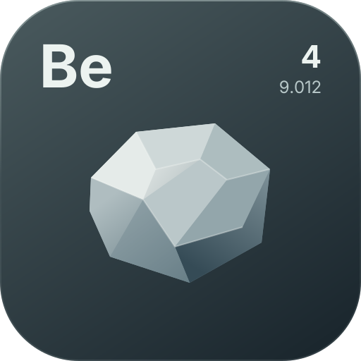

[](../README.md)

# Events

Beryllium's public hook surface is a synchronous event bus. The full artifact declares two client entrypoints in `fabric.mod.json`: `wtf.traumadev.beryllium.Core` calls `Renderer.initialize()`, and `wtf.traumadev.beryllium.ui.UiCore` calls `HudManager.init()` and `UiPrewarm.initialize()` from `onInitializeClient()`. The renderer-only artifact declares only `Core`, so embedders never have to start the layers they ship — subscribing is enough. All events are posted from the client thread by the mixins in `wtf.traumadev.beryllium.mixin` (`GameRendererMixin`, `LevelRendererMixin`, `MouseHandlerMixin`, `KeyboardHandlerMixin`, `MinecraftMixin`).

## Subscribing

```kotlin
val subscription = EventBus.subscribe<FrameEvent>(priority = 0) { event ->
	if (event.phase == FrameEvent.Phase.END) { }
}
subscription.unsubscribe()
```

`EventBus.subscribe<T>(priority, listener)` returns a `Subscription`; `unsubscribe()` deactivates it and removes it from the bus. A `subscribe(type: Class<out T>, priority, listener)` overload exists for Java and interop callers. Dispatch is keyed on the event's **exact runtime class**: subscribing to `Event` or to a supertype receives nothing, so subscribe to `FrameEvent` rather than to a common base.

Ordering is by descending priority — higher numbers run first — and equal priorities run in subscription order within a frame. For cancellable events, `event.isCancelled = true` stops delivery to every lower-priority subscriber; `EventBus.post` returns that cancelled state (and `false` when the event had no subscribers at all).

Custom events work the same way: implement `Event` (or extend `CancellableEvent`) and call `EventBus.post(yourEvent)`.

## Reserved priorities

| Priority | Subscriber | Role |
|---|---|---|
| `-100` | `Renderer` | flushes `Renderer.gui` at `FrameEvent.END` and `Renderer.world` at `WorldRenderEvent` |
| `0` | `UiHost` | relayout + draw of every host at `FrameEvent.END` (screen UIs into `Renderer.gui`, the HUD host into `Renderer.hud`) |
| `90` | `UiPrewarm` | one warmup entity per `FrameEvent.START` once prewarm finishes |
| `100` | `Renderer` | device detection, pipeline compilation, gui metrics, prewarm step, fps sampling at `FrameEvent.START` |
| `150` | `HudInputPolicy` | routes input into HUDs while chat or the HUD editor is open |
| `250` | `Animator` | advances tweens and springs at `FrameEvent.START` |

Any geometry a subscriber records must reach its batch before the matching flush, so draw from a priority strictly greater than `-100` (see `docs/renderer.md`). `Renderer.hud` is flushed outside the event bus, right before the vanilla GUI pass, which is already past by the time `FrameEvent.END` fires: anything a subscriber records into `Renderer.hud` before priority `-100` is drawn in the same frame, while the HUD host's own tree (recorded at `FrameEvent.END`) is submitted by the next frame's `flushHud`.

## Events

| Event | Posted at | Fields | Cancellable |
|---|---|---|---|
| `FrameEvent` | `GameRenderer.render` HEAD (`START`) and TAIL (`END`) | `phase` (`START` / `END`) | no |
| `WorldRenderEvent` | `LevelRenderer.render` TAIL | `cameraX`/`cameraY`/`cameraZ`, `projection` (includes vanilla bob/hurt pose), `viewRotation`, `cameraOrientation` | no |
| `TickEvent` | `Minecraft.tick` HEAD (`START`) and TAIL (`END`) | `phase` | no |
| `MouseMoveEvent` | `MouseHandler.onMove` HEAD | `x`, `y` (gui-scaled) | no |
| `MouseClickEvent` | `MouseHandler.onButton` HEAD | `x`, `y`, `button`, `action`, `mods` | yes |
| `MouseScrollEvent` | `MouseHandler.onScroll` HEAD | `x`, `y`, `xOffset`, `yOffset` | yes |
| `KeyPressEvent` | `KeyboardHandler.keyPress` HEAD | `key`, `action`, `mods` | yes |
| `CharTypedEvent` | `KeyboardHandler.charTyped` HEAD | `codepoint` | yes |

Cancelling `MouseClickEvent`, `MouseScrollEvent`, `KeyPressEvent` or `CharTypedEvent` prevents vanilla from seeing that input, which is how the UI and HUD layers take over typing and clicks. Input events are only posted when the event targets the game window and the window is active; `action` uses `com.mojang.blaze3d.platform.InputConstants.PRESS` / `RELEASE` and `button` uses its `MOUSE_BUTTON_*` constants.

## Logging

`wtf.traumadev.beryllium.util.Logger` wraps SLF4J with a `[Beryllium]` prefix (`info`/`warn`/`error`, the last with an optional throwable). `Logger.channel(name)` returns a named `LogChannel` that stays silent until `toggle()` enables it; `Logger.find(name)` and `Logger.channels()` inspect the registry.

## Demo usage

The test mod's `DemoUi` (Events tab) is a live reference for this page. It records `KeyPressEvent`, `MouseMoveEvent`, `MouseClickEvent`, `MouseScrollEvent` and `CharTypedEvent`, dispatches a custom `CancellableEvent` through subscribers at priorities `20`, `10` and `0`, and displays both the resulting trace and the return value of `EventBus.post()`. A switch cancels the event at priority `10`, which stops delivery to priority `0`; the same tab toggles a `Logger` channel and writes a line to it.
