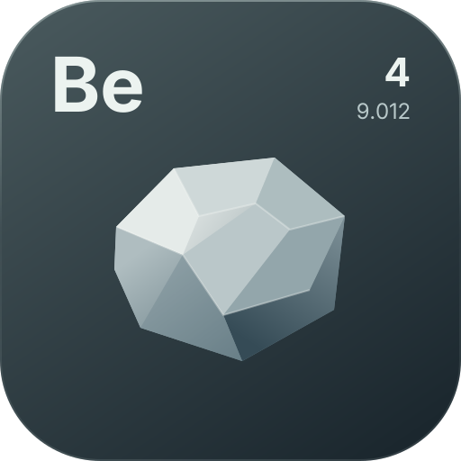

[](../README.md)

# Renderer

Beryllium's renderer is a backend-agnostic immediate-mode drawing layer built on Blaze3D's `GpuDevice` / `CommandEncoder` / `RenderPass` abstraction (the `com.mojang.renderpearl.api` interfaces in 26.3). It contains zero direct GL calls, so it runs identically on the OpenGL and Vulkan backends (whichever the game's `preferredGraphicsBackend` setting selects). Everything below describes the code under `render/`, which is also shipped on its own as the renderer-only `beryllium-renderer` artifact (the full artifact adds the `ui/` layer).

## Frame integration

`Renderer` owns the drawing surfaces (`gui` and `hud` are `Renderer2D` instances, `world` is `Renderer3D`) and wires them into the frame:

| Phase | What happens |
|---|---|
| `FrameEvent.START` | Detects the graphics device, initializes samplers, compiles pipelines through Beryllium's own `PipelineCache` (backed by the mod resource manager — vanilla's fallback cache only reads the vanilla pack), refreshes gui scale/width/height from the Minecraft window, advances glyph prewarm and samples frame times into `Renderer.framesPerSecond` |
| `WorldRenderEvent` | Flushes `Renderer.world` (fired by `LevelRendererMixin` at the tail of `LevelRenderer.render`) |
| `FrameEvent.END` | Uploads pending glyph atlas regions and SVG rasters, then flushes `Renderer.gui` (fired by `GameRendererMixin`) |
| before GUI pass | `Renderer.flushHud()` flushes `Renderer.hud` (injected right before `GuiRenderer.render()` in `GameRendererMixin`) |

Draw from your own event subscriber with **priority greater than -100**: the manager flushes at exactly -100, so subscribers at or below that never get their geometry into the frame. Among subscribers, higher priority numbers draw earlier and therefore appear underneath later ones (within one frame the batcher preserves insertion order).

All batches are cleared by their flush every frame; keep no per-frame state in the renderers.

## Renderer2D (`Renderer.gui`, `Renderer.hud`)

Draws in **gui-scaled pixels** (vanilla GUI space): origin top-left, y grows downward, `guiScale` / `guiWidth` / `guiHeight` are refreshed each frame. The orthographic projection flips y, which is why every 2D pipeline must be built with `.withCull(false)` — clockwise-wound quads would otherwise be culled.

### Transforms
- `pushMatrix()` / `popMatrix()` — `Matrix4fStack`, depth 24; unbalanced pushes are checked.
- `translate(x, y, z = 0f)`, `rotateZ(radians)`, `scale(x, y)`.
- Transforms are baked into vertex positions at record time (CPU side), not on the GPU.

### Scissors
`pushScissor(x, y, width, height)` / `popScissor()` form an intersecting stack; a batch is tagged with its scissor and the device-space rect is applied per draw. A fully clipped scissor skips the batch entirely.

### Primitives
| Call | Notes |
|---|---|
| `rect(x, y, w, h, color)` | Solid quad |
| `gradientRect(..., top, bottom)` / `gradientRectH(..., left, right)` | Vertical / horizontal gradients |
| `outline(x, y, w, h, color, thickness = 1f)` | Four rects |
| `roundedRect(x, y, w, h, radius, color)` | Radius clamped to half the shorter side; corner fans at 4 segments |
| `triangle(x1, y1, ..., color)` | Single triangle |
| `circle(cx, cy, r, color, segments = 32)` / `arc(...)` | Triangle fans |
| `line(x1, y1, x2, y2, thickness, color)` | Quad expanded along the normal (screen space, not affected by matrix scale beyond coordinate baking) |
| `image(texture, x, y, w, h, color = WHITE, sampling = LINEAR, uniforms = null)` | Full-texture quad |
| `imageRegion(texture, ..., u0, v0, u1, v1, color, sampling, uniforms)` | Sub-region quad |
| `texturedQuad(texture, ..., pipeline = overlayTextured, sampling = LINEAR, uniforms = null)` | Escape hatch with a custom pipeline |
| `quad(x1, y1, ..., x4, y4, color, pipeline = overlayColored, uniforms = null)` | Arbitrary four-corner quad with a custom pipeline |
| `mesh(pipeline, mesh, texture = null, sampling = LINEAR, uniforms = null)` | Raw vertex bytes for the pipeline's own `VertexFormat`; scissor applies, the matrix stack does not |
| `sdfRect(x, y, w, h, radius, fill, fillBottom = fill, borderColor, borderWidth, shadowColor, shadowOffsetX/Y, shadowSpread)` | SDF rounded rect: analytic AA fill, border, outer shadow/glow in one quad; axis-aligned only (per-vertex params, no matrix rotation) |
| `text(text, x, y, size, color, font, shadow)` | `y` is the line top; returns the advance in gui px |
| `textWidth(text, size, font)` | Real glyph advances + kerning |

### Colors
Colors are ARGB ints. `Colors` provides `rgb` / `rgba`, `withAlpha`, `multiplyAlpha`, component getters, `lerp`, `hex("#RRGGBB" or "#AARRGGBB")`, plus `WHITE`, `BLACK`, `TRANSPARENT`. Gradients accept a color per corner/edge.

### Batching
Record calls append to batches keyed by `(pipeline, texture, topology, scissor, sampling, uniforms)`; `uniforms` is the `ShaderUniforms` instance identity, so mutating one after recording affects every batch that shares it. At flush, each batch's vertices go into a `GpuBufferPool` buffer and one indexed draw is issued (`RenderSystem`'s shared sequential quad/line index buffers). Fewer state changes win: draw same-texture, same-pipeline geometry consecutively. Custom registered pipelines take part in the same batching; only batches whose pipeline compiled are drawn.

## Text

- `Fonts.regular` and `Fonts.bold` — Inter 18pt Regular/Bold, bundled at `assets/beryllium/fonts/`; `Fonts.find(name)` looks up any registered face. All faces share one internal `GlyphAtlas`.
- `Fonts.register(name, bytes)` — parses TTF/OTF bytes with the native library and returns a `FontRenderer` usable anywhere a font is accepted. Names are case-insensitive and must be unique (`IllegalArgumentException` otherwise); registration requires `Fonts.nativeAvailable`, and unparseable bytes raise `IllegalArgumentException`. `Fonts.unregister(name)` releases the native face and removes it from `Fonts.names`.
- `font.lineHeight(size)` / `font.baselineOffset(size)` — for stacking lines and aligning baselines of mixed sizes.
- `TextLayout.wrap(text, font, size, maxWidth)` — greedy word wrap; preserves `\n`; never loses words; a single word wider than the line is hard-split at character granularity. Results are memoized per `(font, size, maxWidth, text)` in a bounded LRU.
- Shadow draws the run again in black at `size/8` offset with the source alpha.

Glyphs are generated by the Rust native library as multi-channel signed distance fields at a **64 px em with a 2 px range**, packed into row-grown 1024² atlas pages (each cell padded with zeros so linear filtering never samples undefined texels). The MSDF shader derives a ~1 px screen-space AA ramp via `fwidth`, so text stays crisp from 4 px to arbitrarily large sizes. Unknown code points fall back to `?`. If the native library is missing the text system is disabled with an error log — there is deliberately **no software fallback**.

Font metadata (glyph id per code point, advance, kerning pairs) is cached Kotlin-side in `NativeFontFace`, so steady-state text drawing and measurement never cross JNI. The atlas caches both rasterized glyphs and glyphs known to have no outline (e.g. space), and an internal prewarm step rasterizes the printable ASCII + common Latin set for every registered face during `FrameEvent.START` after the device exists — budgeted per frame (~1 ms) until complete, so the first UI/HUD/text draw never pays a rasterization spike.

## Renderer3D (`Renderer.world`)

World-space overlays drawn during `WorldRenderEvent`. Pass the `event` you received into every call — positions are rebased against `event.cameraX/Y/Z` and flushing uses `event.projection` (which re-composes vanilla's view-bob/hurt-cam pose — never rebuild matrices from the raw camera state or overlays will jitter) plus `event.viewRotation`.

| Call | Notes |
|---|---|
| `quad(x1..x4, color, event, pipeline = worldColored)` | Arbitrary world quad, depth-tested; pass a registered `POSITION_COLOR` custom pipeline to override the shader |
| `boxFaces(min, max, color, event)` | All six faces of a box |
| `line(start, end, thicknessPx, color, event)` | Depth-tested line; width is screen px expanded in clip space (format `POSITION_COLOR_NORMAL_LINE_WIDTH`) |
| `boxEdges(min, max, thicknessPx, color, event)` | All 12 box edges |
| `imageQuad(texture, x1..x4, color, event, pipeline = worldTextured)` | World quad with UV 0..1; each texture gets its own batch, and a registered `POSITION_TEX_COLOR` custom pipeline overrides the shader |

World pipelines blend translucently and depth-test with `GREATER_THAN_OR_EQUAL` against the world's depth texture without writing depth, so geometry hides behind terrain and shows through nothing else. A custom world pipeline only gets that depth state if its builder sets the same compare op (or calls `.depthTest(...)` with another value).

## Pipelines and shaders

`Pipelines` (internal) defines: `overlayColored`, `overlayTextured`, `overlayMsdf`, `overlaySdf`, `worldColored`, `worldTextured`, `worldLines`. Shaders are GLSL 330 under `assets/beryllium/shaders/core/`; every vertex shader inlines the shared std140 uniform block `Transforms` (`ProjMat`, `ModelViewMat`, `ScreenSize`) that `TransformUbo` writes once per flush.

26.3 compiles shaders through shaderc into SPIR-V, so every shader must carry `#extension GL_ARB_separate_shader_objects : require` and explicit `layout(location = N)` on all vertex inputs and outputs (the `gl_VertexID` builtin is `gl_VertexIndex` in this pipeline).

`overlaySdf` uses a custom vertex format ( `Position`, `Color`, plus `LocalPos`, `HalfSize`, `Radius`, `BorderWidth`, `BorderColor`, `ShadowColor`, `ShadowParams` ) carrying the rect's local geometry per vertex, so differently-shaped rects still batch together; the fragment shader derives coverage from a rounded-box SDF with `fwidth`-based AA and composites border over fill over shadow premultiplied.

To add a built-in pipeline: write the `.vsh`/`.fsh`, declare it in `Pipelines` via `builder(...)` (bind `transformLayout`, plus `sampler0Layout` for textured ones), set vertex format and topology, and **add it to `Pipelines.all`** — that list drives compilation. Pipelines are readiness-gated: on the first frame with a graphics device, every pipeline in `Pipelines.all` compiles synchronously through the mod `PipelineCache`; a pipeline that fails is logged once and permanently skipped by flushes. Hard requirements when touching vertex data: the vertex element order must match the `VertexFormat` exactly (`POSITION_TEX_COLOR` = Position, UV0, Color) and 2D pipelines need `.withCull(false)`.

### Custom pipelines

Embedders add shader-backed pipelines with `RenderPipelines` instead of touching `Pipelines`:

```kotlin
val pipeline = RenderPipelines.builder(Identifier.fromNamespaceAndPath("mymod", "gradient"))
    .vertexShader(Identifier.fromNamespaceAndPath("mymod", "core/gradient"))
    .fragmentShader(Identifier.fromNamespaceAndPath("mymod", "core/gradient"))
    .vertexFormat(DefaultVertexFormat.POSITION_TEX_COLOR)
    .topology(PrimitiveTopology.QUADS)
    .blend(BlendFunction.TRANSLUCENT)
    .depthTest(null)
    .cull(false)
    .sampler(true)
    .register()
```

- Shader ids resolve through the mod resource manager, so `mymod:core/gradient` reads `assets/mymod/shaders/core/gradient.vsh` / `.fsh` from your jar. Both shaders must declare the `Transforms` block and explicit `layout(location = N)`; the vertex shader must match the declared `VertexFormat` element order exactly.
- The builder always binds Beryllium's `Transforms` UBO. The `sampler` flag adds the `Sampler0` combined-image-sampler layout; Beryllium binds it with the draw's `TextureSampling` when a batch carries a texture.
- `.uniformBuffer(name)` and `.texture(name)` declare extra bindings. At draw time pass `ShaderUniforms`, where `uniform(name, ByteBuffer | FloatArray)` supplies std140 bytes and `texture(name, texture, sampling)` supplies an extra sampler binding. `uniform(name, floats)` writes native-order little-endian floats; pad structs to std140 alignment yourself. Beryllium uploads uniform data before the render pass and binds each declared name. Every declared binding must be present in the `ShaderUniforms` passed with the draw; names the pipeline did not declare are a validation error.
- `.vertexFormat(...)` may name any `VertexFormat`; draw such pipelines with `Renderer2D.mesh(Mesh.of(bytes, vertexCount, topology), ...)`. Vertex data must match the layout byte-for-byte, including normalized color bytes (RGBA). Topologies other than `QUADS` and the built-in line pipeline draw non-indexed.
- `register()` (or `RenderPipelines.register(pipeline, bindsSampler)`) enqueues the pipeline. The next `FrameEvent.START` with a device compiles it; failures are logged once and permanently skipped. `RenderPipelines.isRegistered(pipeline)` and `Renderer.pipelineReady(pipeline)` report registry and compile state. Pipelines may be registered at any time, including after the built-ins settled.
- Draw with `Renderer2D.texturedQuad(..., pipeline)` (`POSITION_TEX_COLOR`), `Renderer2D.quad(..., pipeline)` (`POSITION_COLOR`), `Renderer2D.mesh(pipeline, mesh, ...)` (any format), `Renderer3D.quad(..., pipeline)` or `Renderer3D.imageQuad(..., pipeline)`. Batches whose pipeline is not ready are skipped, so polling `pipelineReady` only affects whether the earliest frames show the geometry.
- `RenderPipelines.transformsLayout` and `RenderPipelines.samplerLayout` expose the bind-group layouts for manually built `RenderPipeline` instances passed to `register`. Draw calls bind only the layouts the pipeline declares: a `bindsSampler = false` pipeline never receives `Sampler0`.

Note on samplers: 26.3's `BindGroupLayout.Builder` has no `withSampler`; declare samplers as `.withUniform("Sampler0", UniformType.COMBINED_IMAGE_SAMPLER)` and bind them per pass with `pass.setUniform("Sampler0", view, sampler)`.

Embedders do not need to reference internal pipeline constants; the built-in pipelines are selected by the draw call's default argument. Readiness is exposed on `Renderer`: `pipelinesReady` (every internal pipeline compiled), `pipelineReady(pipeline)` (one specific pipeline, custom included), `fontPrewarmComplete` (glyph prewarm finished) and `ready` (renderer initialized, fonts prewarmed and internal pipelines available). `Renderer.backend` reports the detected API as a `GraphicsBackend` (`OPENGL`, `VULKAN` or `UNKNOWN`) and `Renderer.framesPerSecond` the smoothed frame rate. On the font side, `Fonts.nativeAvailable` tells whether the native library loaded and `Fonts.names` lists every registered face; when the native library is missing, `Fonts.regular`/`Fonts.bold` resolve to a no-op renderer (zero-width glyphs), so draw and measure calls stay valid. `Renderer.flushHud()` stays public only because the Java `GameRendererMixin` calls it.

## Textures, samplers and buffers

- `Texture2D.create(label, width, height)` — RGBA8, texture-binding + copy-dst usage.
- `Texture2D.upload(source)` / `upload(x, y, width, height, source, offset, stride)` — RGBA8 bytes copied through a command encoder on the render thread; the full-surface overload assumes `stride = width * 4`.
- `TextureSampling.LINEAR` / `NEAREST` — per-draw filter selection (`image`, `imageRegion`, `texturedQuad`, `Renderer3D.imageQuad`, `ShaderUniforms.texture`). Both samplers are CLAMP_TO_EDGE with no mipmaps; `LINEAR` is the default.
- `TextureUploader` (internal) — CPU staging + `CommandEncoder.writeToTexture` behind the public upload methods; copies are byte-wise (endian-safe).
- `GpuBufferPool` (internal) — frame-scoped vertex and uniform buffers recycled behind a fence; `endFrame()` releases last frame's buffers.

## Offscreen rendering (`RenderTarget2D`)

`RenderTarget2D.create(label, width, height)` builds an RGBA8 `TextureTarget` using the vanilla render target machinery:

- `draw(clearColor = Colors.TRANSPARENT) { g -> ... }` draws through an internal `Renderer2D` at 1:1 device pixels, clears the target when `clearColor` is non-null, then flushes with its own transform UBO. Call it on the render thread.
- `color` is a `Texture2D` wrapper over the target's color attachment, safe to pass to `image`, `texturedQuad`, or any custom pipeline. Content is stored top-down (the flush projection is vertically flipped), so `image(target.color, ...)` and `imageRegion` display it upright without V flipping. Re-read `color` after `resize`, which recreates the attachments.
- `resize(width, height)` and `close()` manage attachment lifetimes. Do not call `color.close()`; the target owns that texture.
- Offscreen flushes share Beryllium's vertex and uniform pools, so they must happen on the client/render thread inside the frame; text, SVG, custom pipelines, and raw meshes all work in the target's pass.

## SVG (`render/svg/`)

`SvgImage` parses an SVG with the bundled [jsvg](https://github.com/weisJ/jsvg) library (jar-in-jar; the default `LoaderContext` has no external resource loader, so only markup that is already in hand is parsed) and rasterizes it with Java2D into straight-alpha RGBA pixels:

- `SvgImage.ofSource(source, label, rasterScale)` — from SVG markup; `SvgImage.ofFile(path, label?, rasterScale)` — from disk (registered with the file watcher); `SvgImage.ofResource(resourcePath, ...)` — from a classpath resource. All register with `Svgs`; `close()` unregisters and frees the GPU texture.
- Raster size is the document's intrinsic size × `rasterScale` (default 4, clamped to 4096 px per side); `rasterize(width, height)` re-rasterizes at an explicit size. `size == 0` documents (no width/height/viewBox) degrade to 1×1.
- GPU work is deferred: rasterization only fills a pending CPU buffer; `Svgs.uploadPending(encoder)` runs at the same hook points as `Fonts.uploadPending` (before the hud flush and at `FrameEvent.END`) and creates/replaces the `Texture2D` there — safe before the graphics device exists, since nothing touches the device until the first flush.
- `image` is `null` until the first upload and may be **replaced** when a reload changes the raster size — always dereference `svg.image` at draw time. `ImageSource` (`render/texture/ImageSource.kt`) is the shared seam (`Texture2D` implements it as itself); `addChangeListener` fires when the texture is created or swapped, which is how `ImageView` re-layouts.
- Hot reload: `Svgs` (always on once a file-backed SVG exists) watches the parent directories of file-backed images, debounces ~400 ms, and re-reads/re-parses/re-rasterizes on the client thread. A failed parse logs and keeps the last good texture.
- No new pipeline: SVG textures draw through the existing textured pipeline (`BlendFunction.TRANSLUCENT`, straight alpha — pixels are uploaded non-premultiplied). Tinting works via the normal vertex-color multiply.

## Native font library (`native/`)

Rust cdylib `beryllium_native`: parses fonts with `ttf-parser`, resolves kerning (GPOS, falling back to legacy `kern`), and generates MSDF glyphs with `bymsdfgen-core` plus an exact texel-level sign-correction pass (scanline winding). `NativeFont` (Kotlin) talks to it over JNI (symbols `Java_wtf_traumadev_beryllium_render_font_NativeFont_*`); the compiled library ships under `resources/natives/<platform>/` for `windows-x86_64`, `linux-x86_64`, `macos-x86_64` and `macos-aarch64`. Gradle builds it automatically (`buildNativeFont`, skipped silently when cargo is unavailable); manual rebuild: `cargo build --release` from `native/`. A local build bundles only the host platform; releases cross-compile every platform in the Linux job with cargo-zigbuild and pass the collected tree with `-Pnative_resources_dir=<dir>`, which adds the prebuilt `natives/` tree and skips the host build.

Verification tools (run from `native/`):
- `cargo run --release --example sheet -- <font.ttf>` — renders every glyph shader-exactly and compares against an analytic supersampled reference, classifying holes/core-dips/speckles per size; writes magnified exports to `native/test/out/` (gitignored). `GLYPH_EM` overrides the raster em.
- `cargo run --release --example dump -- <font.ttf> <char>` — ASCII dump of the raw distance field plus renders at two sizes.

Invariants worth preserving: the MSDF range must stay far smaller than the thinnest stroke (current 64 em / 2 px range — wider bands invert narrow-feature interiors once filtered, which used to wash out and break glyphs); the distance mapping range is expressed in font units (`range_px / scale`), and the generated bitmap is already normalized [0,1].

## Demo entities

`DemoHud` (registered and opened by the test mod entrypoint `BerylliumTestMod`) is an anchored bottom-left panel and the standing proof that batching, the SDF pipeline, the font atlas and the hud flush all work on 26.3. It draws a drop-shadowed SDF panel with a vertical fill gradient, an SVG icon, regular/bold MSDF text, an FPS sparkline built from `Renderer2D` lines and circles inside a custom view, read-only checkboxes for renderer readiness, and a pulsing animated status dot. Its buttons cycle the anchor corner and open the HUD editor; they receive input only under the HUD input policy (chat open or editor mode).

`DemoUi` (registered, open it with **Insert** or `DemoUi.open()`) is a tabbed showcase window. The `Canvas` tab draws every `Renderer2D` primitive — rects, both gradient directions, outline, rounded rect, SDF fill/border/shadow, triangle, circle, arc, line, full and region images, color helpers, matrix transforms and scissor clips — directly through `Renderer.gui` from a custom view's draw pass, alongside MSDF text sizes, bold text, shadows and `TextLayout.wrap`. The `World` tab toggles a `Renderer3D` overlay that draws box faces, edges, a line, an arbitrary quad and an SVG-backed `imageQuad` around the player's look target; it stays enabled after the UI closes, so the depth-tested world pass can be inspected in normal play. The `Events` tab dispatches a custom cancellable event through three priority-ordered subscribers and toggles a `Logger` channel, and the other tabs exercise the full UI component set.

Both live in the `beryllium-test-mod/` subproject alongside the selftest harness, so they double as living examples of an embedding mod; neither ships in the beryllium jar. `DemoAssets` owns the shared SVG images created with `SvgImage.ofResource` and `SvgImage.ofSource`.

For automated end-to-end verification of everything above (pixel-asserted screenshots in a real world), see `docs/selftest.md`.
