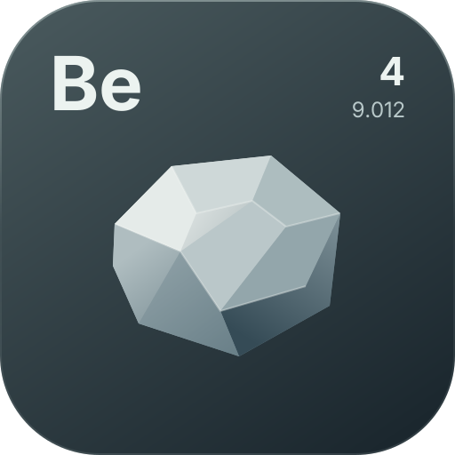

[](../README.md)

# Selftest

The dev-only end-to-end test harness is a separate Gradle subproject, `beryllium-test-mod/`, kept in `beryllium-test-mod/src/main/kotlin/wtf/traumadev/berylliumtestmod/selftest/`. It is **not** part of the API and is never packaged into the beryllium jar: it never activates in a normal game run and exists so the renderer and UI stack can be verified automatically on a real client.

## Running

```
gradlew runSelftest
```

From IntelliJ, the **Run SelfTest** run configuration (`.idea/runConfigurations/Run_SelfTest.xml`) runs the same task. For a plain interactive client with the test mod loaded, use **Run TestMod** (`.idea/runConfigurations/Run_TestMod.xml`, task `:beryllium-test-mod:runClient`); running the client from the root project would boot Beryllium without the demo entities.

The `selftest` Loom run configuration (see `beryllium-test-mod/build.gradle.kts`) launches the client in its own `run-selftest/` game directory at 1280x720 with `-Dberyllium.selftest=true`. The root `build.gradle.kts` disables `ideConfigGenerated` for every Loom run, so Gradle sync never writes or rewrites `.idea/runConfigurations` entries and the project-level run configurations above stay authoritative. In selftest mode the default `DemoHud` open is skipped and no keys are injected, so the demo keybinds (Insert/Home) never fire; `DemoHud` is fully controlled by the harness (`tickPrepare` closes it; the `hud` scenario opens and closes it itself). The harness then, without any user input:

1. Waits for the loading overlay to clear, then forces the title screen — any other screen (such as first-launch onboarding) is cleared first.
2. Forces a deterministic environment: gui scale 2, `pauseOnLostFocus` off.
3. Deletes and re-creates the world `beryllium-selftest` (fixed seed, creative, peaceful, cheats on) via `WorldOpenFlows.createFreshLevel`, and joins it.
4. Freezes the environment: `advance_time`/`advance_weather`/`spawn_mobs`/`fall_damage` off, time 6000, clear weather, night vision, zero gravity, quiet command feedback.
5. Runs each scenario: set up state, draw through the real frame/world events, capture the frame, assert pixels.
6. Writes `run-selftest/selftest/report.json` plus one PNG per scenario, then stops the game. The process exits **0 when everything passes, 1 on any failure, 3 on watchdog timeout**. The report records `success`, duration, the graphics backend, window/gui scale, `fontPrewarmComplete`, `pipelinesReady`, world time, global failures and per-scenario failures.

## Configuration (JVM properties)

| Property | Default | Meaning |
|---|---|---|
| `beryllium.selftest` | (unset = off) | Presence activates the harness |
| `beryllium.selftest.world` | `beryllium-selftest` | World folder name under `saves/` (deleted and recreated each run) |
| `beryllium.selftest.seed` | `20241028` | World seed |
| `beryllium.selftest.timeout` | `300` | Global watchdog timeout in seconds |

## Scenarios

Defined in `SelftestScenarios.kt`; each produces `<name>.png` and a list of assertion failures.

| Scenario | What it proves |
|---|---|
| `world` | `Renderer3D` box faces/edges/lines render depth-tested in world space at the expected screen position |
| `hud` | `Renderer.hud` flush path and `Hud` anchoring (the DemoHud showcase panel bottom-left over sky) |
| `primitives` | `Renderer2D` rect, gradients (vertical/horizontal), outline, roundedRect corners, triangle, circle, arc, line, SDF fill/border/shadow — exact pixel assertions on a black backdrop |
| `text` | MSDF text at 8/14/24/36 px, shadow offset darkening, `TextLayout.wrap` line breaking |
| `transform_scissor` | matrix stack (translate/rotateZ/scale) and intersecting scissor stack |
| `svg` | `SvgImage.ofResource` parse → rasterize → upload → draw |
| `extensions` | `RenderPipelines.builder(...).register()` compiles the test mod's `demo_gradient` shader; an SVG-backed quad asserts a vertical gradient; a `demo_mesh` pipeline draws a raw `Mesh` triangle with a `TintBlock` `ShaderUniforms` uniform block and an extra nearest-sampled `Mask` texture (both halves asserted); a 2×1 uploaded texture drawn with `TextureSampling.NEAREST` asserts both texels; an offscreen `RenderTarget2D` (green/blue halves) is sampled back into the main pass; and text renders in the `Fonts.register("demo", ...)` face loaded from the test mod's `Oswald-Regular.ttf` |
| `ui_demo` | `Ui` screen hosting: the DemoUi showcase window (background, title and tab bar) over the live world |
| `ui_interaction` | end-to-end input: synthetic mouse clicks flip a `Toggle`, drag a `Slider`, click a `Button`, type into a `TextField` through `UiScreen` callbacks |

Assertions sample the captured `NativeImage` in device pixels; `Capture` maps gui coordinates through the real gui scale, so scenarios are resolution-independent. The `ui_demo` scenario reads the window bounds from `DemoUi.screenWindow`, so the showcase can change size or position without rewriting assertion coordinates.

## Extending

Add a `Scenario(name, warmupTicks, setup, teardown, drawGui, drawWorld, verify)` to `SelftestScenarios.all()`. `drawGui`/`drawWorld` run every frame while the scenario is active; `verify` receives the captured frame and returns failure strings (empty = pass). Subclass `Scenario` and override `onTick()` for multi-step interaction flows (see `InteractionScenario`).

Design constraints worth keeping: the harness drives the game only from the client thread (tick/frame events), touches no production internals — it compiles against the public API only (`internal` declarations are invisible across the module boundary), observes readiness through `Renderer.ready` / `Renderer.fontPrewarmComplete` / `Renderer.pipelinesReady`, and uses the demo entities, which also live in the test mod; no API code references the test mod in either direction. It stays dormant unless `-Dberyllium.selftest` is set.
