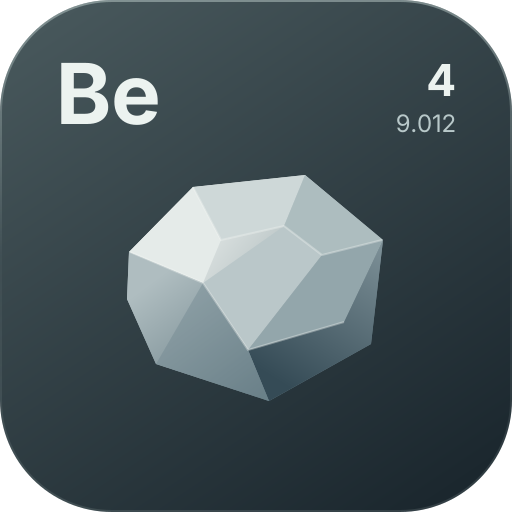

[](../README.md)

# UI

Beryllium's UI framework is a retained-mode view tree drawn by the custom renderer. It has two host flavors: screen-backed UIs are hosted in a vanilla `Screen` by the internal `UiScreen` and receive input through its callbacks, while HUDs are vanilla-independent — drawn below every vanilla GUI layer and fed by the global mouse/keyboard events. Everything below describes the code under `ui/`.

## Architecture

| Layer | Path | Role |
|---|---|---|
| Views | `ui/View.kt`, `ui/ViewGroup.kt` | Retained tree nodes; measure/arrange/draw/input |
| Layout containers | `ui/layout/` | `Row`, `Column`, `LinearLayout`, `Box`, `Flow`, `ScrollView`, `Size`, `Padding`, alignments |
| Drawing | `ui/draw/UiCanvas.kt` | Facade over `Renderer2D`; per-view translate/clip/alpha; `panel` routes to `Renderer2D.sdfRect` |
| Hosts | `ui/Ui.kt`, `ui/hud/Hud.kt` (public entities); `ui/UiHost.kt`, `ui/UiScreen.kt` (internal) | Own a root; relayout + redraw each frame; route input, focus, tooltips, overlays |
| Animation | `ui/anim/` | `Animator` clock, `Animatable` tweens, `SpringFloat`, `Easings`, view helpers |
| Components | `ui/component/` | `Panel`, `Card`, `TextView`, `ImageView`, `Button`, `Toggle`, `Checkbox`, `Slider`, `ProgressBar`, `TextField`, `Dropdown`, `TabBar`, `Window`, `TooltipView` |
| DSL | `ui/dsl/` | Builder scopes; container builders in `UiDsl.kt`, component builders in `ComponentDsl.kt` |

Callback lambdas are always the **last** parameter of a DSL function so trailing-lambda syntax binds to the callback, not a `Size`.

## Views

`View` is the base class. State: `widthSpec`/`heightSpec`, measured `x`/`y`/`width`/`height` (relative to parent; `absoluteX`/`absoluteY` computed), `visible`, `alpha` (multiplies down the tree), `clipContent` (scissor to own bounds), `interceptsInput`, `manuallyPositioned` (parent layout re-applies current `x`/`y` instead of aligning), `zIndex` (paint + hit-test order within a parent), `focusable`/`focused`, `id` (+ `findById`).

Size specs (`ui/layout/Size.kt`): `Fixed(px)`, `Fill(fraction = 1f)` — fraction of the offered space, and `Wrap` — content-driven. Unresolvable cases degrade gracefully: `Fill` inside unbounded space (a `ScrollView` with infinite height) behaves as `Wrap`.

`ViewGroup` mutates through `addChild`/`removeChild`/`clearChildren`; the child list itself is `internal`, so a custom container outside the module cannot enumerate children to lay them out — compose the built-in containers instead.

Overridable hooks: `onMeasure`-style `measure(availableWidth, availableHeight)` (set your size via `resolveSize`), `onArrange` (position children — for containers inside the module), `onDraw`/`drawContent` (canvas is already translated/clipped/alpha-applied), and the input hooks `onMouseEnter/onMouseExit/onMouseMove/onPress/onRelease/onClick/onDrag/onScroll/onKey/onChar/onFocusGained/onFocusLost`.

`requestLayout()` marks the host dirty; the next frame re-runs the full measure/arrange pass. Full redraws happen every frame — components animate by mutating values, no draw invalidation needed.

## Layout

Two-pass: containers measure children (resolving each child's specs against offered space), resolve their own size from content, then arrange children. `LinearLayout` (base of `Row`/`Column`) offers `Fill` children their fraction of the free main-axis space after `Wrap`/`Fixed` siblings and gaps; `Fill(0.5f)` twice therefore splits free space evenly. Cross axis supports `START/CENTER/END/STRETCH` — `STRETCH` re-measures `Wrap` children at the container's cross size. Main axis adds `SPACE_BETWEEN`/`SPACE_AROUND` (both ignore `gap`).

`Box` stacks children with a 9-way `Alignment`; a `Window` built through the DSL carries its own `alignment`, which overrides the stack default for that child. `Panel` is a `Box` that draws an SDF background (fill, vertical gradient via `fillBottom`, border, drop shadow/glow). `Card` is the interactive sibling: same SDF background, but with hover/press fill+border springs (same pattern as `Button`) and an `onClicked(button)` callback that fires for every mouse button (0 left / 1 right / 2 middle) on release-inside; compose card content as children and set `interceptsInput = false` on them so the card itself receives the clicks (hit-testing has no parent bubbling). `ScrollView` stacks its children vertically, clips, wheels vertically (`scrollSpeed` gui px per notch), and draws a scrollbar when content overflows; children wider than the viewport shrink by the scrollbar width automatically.

`Flow` packs children left-to-right into rows, wrapping when the next child would overflow (`gap`, `padding`); a lone child wider than the container shrinks to fit while `flexShrink` stays true, and `flexGrow` spreads the leftover width evenly across each row. It has no DSL builder: add it with `add(Flow().apply { ... })` (`UiScope.add` takes any `View`).

`Button` gains a `selected` state (`selectedColor`/`selectedBorderColor` override the idle look while selected) for tabs and navigation; the selection color springs in, and an optional leading `icon` (`ImageSource` + `iconSize`/`iconSpacing`/`iconTint`/`selectedIconTint`, `contentAlignment` LEFT/CENTER/RIGHT) draws before the label. `Toggle`/`Checkbox` expose `checked` as a settable property so callers can drive the knob/check spring programmatically (e.g. as a read-only status indicator with `interceptsInput = false`); the toggle knob colors are configurable per state (`knobColor`, `knobOnColor`, `knobOffColor`).

`TabBar` is the tabbed-page header: tabs are added programmatically (`addTab(label, icon)` / `clearTabs()`), each tab renders an optional leading icon and spring-animates hover/press/selection, and a rounded underline indicator springs between the selected tab's bounds (`indicatorColor`/`indicatorHeight`/`indicatorRadius`). `selected` is settable programmatically (no callback fire) while clicks call `onSelected(index)`; layout is a left-aligned row (`gap`, `padding`, `textSize`, per-state text/icon colors) with the indicator drawn along the bottom edge.

`TextField` is single-line editing: `text` (settable), `cursor`/`setCursor`, `hint` (drawn while empty and unfocused), click/drag caret placement with shift selection, Ctrl+A/C/X/V, Backspace/Delete/arrows/Home/End, Enter fires `onSubmitted`, every edit fires `onTextChanged`; drawing clips through `pushClip`/`popClip` and blinks the caret after activity stops. `ProgressBar` clamps `progress` to 0..1 and springs the fill. `Dropdown` shows `hint` until a row is picked: a click opens an overlay popup (flipping above the field when it would overflow, scrolling past `maxVisible`) behind a click-barrier that closes on an outside press or Escape; `selected`/`selectedOption`/`isOpen` expose state and `onSelected(index, value)` reports picks.

`Box`/`Panel`/`Card` support `padding` — children measure and arrange inside the inset area, with 9-way alignment resolved against the padded bounds — and `ScrollView` supports `padding` for inset scroll content (the scrollbar sits inside the right padding).

Windows are the fitted floating container: their measured size is clamped to the offered space (inset by `screenMargin` on every side when the window sets one), and when the content does not fit it scrolls inside the window (wheel + scrollbar through an internal viewport), so a window never leaves the screen regardless of window size. The chrome is optional: `titleBar` (default true — title text, divider and close hitbox; false frees the bar height and disables bar dragging), `draggable` (default true — title-bar dragging), `scrollContent` (default true — children live in the internal scroll viewport; false attaches them directly to the window for fixed layouts like multi-pane menus, while the screen clamping still applies), `closable` (default true — the X and its hitbox; false hides both) and `onClose` (what the X runs; the `Ui` hooks root windows to `close()`, and a window without a handler detaches itself). The close X is drawn from two lines with round caps (four small circles).

Input constants come from `com.mojang.blaze3d.platform.InputConstants` (`PRESS`/`RELEASE`, `MOUSE_BUTTON_LEFT`, `KEY_*`, `MOD_*`) — 26.3 moved the client off GLFW onto SDL and the GLFW classes are no longer on the classpath.

## Hosts, input and focus

`UiHost` (internal) is a pure router and drawer. It takes a root view, relayouts it when dirty or when the gui dimensions change, draws it (plus overlays) at `FrameEvent.END` priority 0, routes input primitives into the tree, and owns focus/hover/press/tooltip state. It references no input source — whoever creates a host feeds it:

- screen hosts: the internal `UiScreen` forwards the vanilla `Screen` callbacks (mouse/key/char/scroll, including `keyReleased`),
- the HUD host: the internal `HudInputPolicy` (see below).

Routing rules: hit-testing walks overlays (reverse insertion) then the root, deepest-first in reverse z-order; `interceptsInput` (default true) decides whether a container itself is a target (`ui {}` roots set it false). A press on a view consumes; the matching release is consumed too, with `onClick` fired only when released inside; pressed views receive `onDrag` deltas anywhere. Scroll bubbles from the deepest view up. Keys/chars go to the focused view; clicking a `focusable` view — or its nearest focusable ancestor — focuses it; clicking empty space clears focus. `onEscapeFocusOrOverlay()` is the layered Escape protocol (focus → topmost overlay's `onEscape()`) used by screens and the HUD editor. `dispose()` unwinds subscriptions and all per-view input state. Hovering a view registered with `withTooltip { "..." }` opens a `TooltipView` overlay after 400 ms, tracking the mouse until the hover ends.

**`Ui` entity**: subclass `Ui` (e.g. `object MyUi : Ui("myui")`) with `override fun UiScope.build()`. `open()` enforces the single-UI rule — **one UI open at a time**: opening another silently stops the active one, and re-opening the same UI while it is open restarts it fresh (the view tree is rebuilt). `close()` is idempotent; Escape/X close the Ui itself. Root-child `Window`s get a close handler that closes the UI unless customized (default without one: detaching itself). UIs are registered via `UiManager.register(ui)`; `find(name)` looks one up, `unregister(ui)` removes it and closes it, and `toggle()` flips state programmatically. `isOpen` reports the state, while `onOpened()`/`onClosed()` are the override hooks. Open them from code or a custom keybind of the embedding mod.

**Warmup** (internal `UiPrewarm`): once the font prewarm finishes and the device exists, it runs one entity per `FrameEvent.START` — each registered `Ui`'s root (kept as its cached root), each registered `Hud`'s element, and the HUD editor root — building, laying out and recording it into a scratch `Renderer2D` that is never flushed. This pays class loading, JIT warmup of the build/layout/draw path, vertex-writer growth and any remaining glyph rasterization before the first real open; open entities are skipped. Batches are pooled across frames in `Renderer2D`, so recording a frame allocates nothing steady-state.

## HUD layer (`ui/hud/`)

**`Hud` entity**: subclass `Hud` (e.g. `object MyHud : Hud("myhud", HudAnchor.TOP_RIGHT, 0f, 0f)`) with `override fun UiScope.build()`. Register it with `HudManager.register(hud)` (`find(name)` / `unregister(hud)` complete the registry); `open()`/`close()` create and destroy the element, and multiple HUDs can be open at once (module-like). `isOpen` reports state, `toggle()` flips it, and `visible` is copied onto the element when it opens. The constructor's anchor and offsets are the properties themselves — the offsets are fractions of the free span, not pixels.

- **Rendering order**: HUDs draw from a dedicated surface (`Renderer.hud`) flushed inside `GameRenderer.render` right before the vanilla GUI pass (via `GameRendererMixin`) — after the world, **below every vanilla GUI layer** (hotbar, chat, inventory, tab list, F3). Screen-backed UIs draw at `FrameEvent.END`, above those layers.
- `HudElement` is the `Hud`'s anchored `Box` view. The anchor and the offset live on the `Hud`: the offset is a **fraction (0..1) of the free span** on each axis (screen size minus element size), so dragging picks a relative spot and it keeps that relative place when the window resizes. Content is regular DSL, so every component, layout and animation works inside. Anchored positions are re-derived and clamped to the screen on every layout pass, so elements stay visible at any window size.
- **Visibility**: HUDs draw while a world is loaded or while the HUD editor is open (so they can be arranged from the main menu); hidden otherwise.
- **Input model**: HUDs never own input by themselves. `HudInputPolicy` routes the global events into the HUD host only while the **chat screen** is open (that is when the cursor is visible) or while the HUD editor is open. Then clicks on HUD views are consumed (the screen never sees them — chat stays open when you press a HUD button), clicks on empty space pass through, and keys/characters go to a focused HUD field (clicking a HUD `TextField` steals typing from chat) or to chat otherwise. Every other screen (inventory, pause, F3) leaves the HUD inert — it stays drawn below them but never interacts. With no screen open the policy is fully inert too: the cursor is grabbed and the game receives everything.
- **Editor**: `HudManager.toggleEditor()` opens the internal `HudEditorScreen` — a transparent `UiScreen` usable in-world and at the main menu (`openEditor(onClosed)` / `closeEditor()` for explicit control, `editMode` while it is up). While it is open HUDs stay visible; drag elements to move them; Done/Escape exits.

The HUD layer ships no persistence of its own: the embedding mod decides whether and where to persist `anchor/offset/open` (Beryllium intentionally has no storage/keybind/chat systems — `HudManager` only tracks registry state and fires no external callbacks).

## Animation

`Animator` is a global clock subscribed to `FrameEvent.START` using `System.nanoTime()` deltas (clamped to 100 ms). `Animatable<T>.animateTo(target, duration, easing, delay, repeatMode, onEnd)` drives tweens (`AnimatableFloat`, `AnimatableColor`); `RepeatMode.LOOP`/`PING_PONG` never finish until `stop()`. `SpringFloat(stiffness, damping)` integrates per-frame physics and auto-unregisters when settled. `Easings` has linear, quad/cubic in-out, back, elastic and bounce curves.

View helpers: `fadeTo(target, duration, easing)` animates `alpha`; `slideTo(targetX = null, targetY = null, ...)` animates position — only meaningful for `manuallyPositioned` views, since normal layout overwrites `x`/`y`.

## Drawing

`UiCanvas` multiplies every color by the accumulated view alpha, translates and clips per view, and exposes `rect`, `panel` (SDF fill/border/shadow/glow), `text`/`textWidth`/`wrap`, `image`/`imageRegion`, `circle`, `line`, `triangle`, plus `pushClip`/`popClip` for local-coordinate scissor (e.g. the text field's inner clip). Content beyond a view's `clipContent` bounds is scissored by the host automatically.

`ImageView` draws an `ImageSource` (`render/texture/ImageSource.kt`) — a plain `Texture2D` or an `SvgImage` — sized `Wrap` to the source's current texture dimensions, tinted via `color`. The texture is dereferenced at draw time and the view listens for texture swaps, so a hot-reloaded SVG updates (and re-measures) without rebuilding the tree. DSL: `image(texture, color, width, height)` and `svg(svg, color, width, height)`.

## Example

```kotlin
object DemoPanel : Ui("demo") {
	override fun UiScope.build() {
		window(title = "Demo", x = 24f, y = 24f, width = Size.Fixed(220f)) {
			text("Hello", size = 16f)
			val bar = progressBar()
			slider(initial = 0.5f) { value -> bar.progress = value }
			button("Close") { close() }
		}
	}
}
```

The `beryllium-test-mod/` subproject ships two showcase entities wired in its own entrypoint `BerylliumTestMod` (the dev-only mod, never part of the API jar). They are bound to key mappings registered through Fabric's `KeyMappingHelper` — **Insert** toggles `DemoUi`, **Home** toggles `DemoHud` (the tick handler ignores clicks while any screen is open or no player exists, and both are skipped entirely in selftest mode).

`DemoHud` is an anchored bottom-left panel, open by default outside selftest runs. It combines an SVG icon, bold and small text, an FPS sparkline drawn by a custom view, read-only `Checkbox` status indicators for renderer readiness, a pulsing `AnimatableFloat` status dot, tooltips, and buttons that cycle the HUD anchor and open the HUD editor. Because HUDs only receive input while chat or the editor is open, the buttons are inert during normal play; that is the HUD input policy in action. The panel is a regular `Hud` view tree, so dragging it in `HudManager.toggleEditor()` updates the anchor offsets and the panel keeps its relative position across resizes.

`DemoUi` is a 600x300 tabbed window that exercises the API breadth: `TabBar` with icons and an animated indicator; `Overview` renderer/readiness readouts and progress bar; `Components` with every component family (`Button` icons and selected state, `Toggle`, `Checkbox`, `TextField`, `Dropdown`, `Slider`, `ProgressBar`, `Card` all-button clicks, `Flow`, gradient `Panel`, `ImageView`/`SvgImage`, tooltips, row/box alignments); `Canvas` drawing every `Renderer2D` primitive, text size, image region, transform and clip through a custom `View`, plus a `RenderPipelines` custom-shader quad, a `Mesh` triangle driven by a `ShaderUniforms` block, a nearest-sampled 2×1 texture, and text in a `Fonts.register` face; `Motion` running `AnimatableFloat`/`AnimatableColor` loops, every easing, `fadeTo` and a slider-driven `SpringFloat`; `World` toggling a `Renderer3D` overlay (faces, edges, line, arbitrary quad and a textured `imageQuad` around the look target, visible after closing the UI); and `Events` recording every input event plus a custom cancellable event with priority-ordered subscribers and a `Logger` channel toggle. The window is fixed-layout (`scrollContent = false`) with one `ScrollView` per tab, drags by its title bar, clamps to the screen and closes through the standard `Window` X or Escape.
The dev-only selftest harness (`docs/selftest.md`) exercises the UI layer end-to-end — window rendering, component interaction via synthetic input, HUD anchoring — and asserts the results on captured frames.

